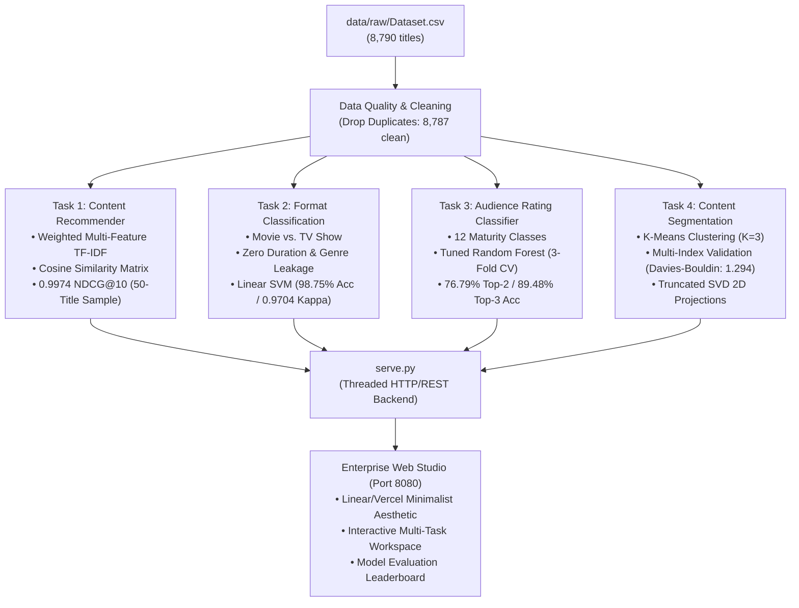

# Auspify Netflix Content Intelligence ML Studio

A comprehensive, production-grade machine learning platform analyzing 8,787 Netflix titles across four enterprise NLP and classical ML workflows: content-based recommendations, zero-leakage format classification, 12-class audience maturity rating estimation, and unsupervised catalog segmentation.

Includes an interactive, minimalist Enterprise Web Studio powered by Vanilla JavaScript, CSS, and a threaded Python REST server.

---

## Architecture Overview



---

## Repository Structure

```text
auspify_intern_task/
├── data/
│   └── raw/
│       └── Dataset.csv                      # Raw Netflix catalog records (8,790 entries)
├── task1/                                   # Task 1: Recommendation Engine
│   ├── outputs/
│   │   ├── model_comparison.csv             # 50-title RecSys audit metrics
│   │   └── model_comparison.png             # Precision, Format Match, Overlap, NDCG chart
│   ├── src/
│   │   ├── data_loader.py                   # CSV loading and shape verification
│   │   ├── data_quality.py                  # Duplicate detection and index reset
│   │   ├── eda.py                           # Content distributions and bar charts
│   │   ├── evaluation.py                    # NDCG@10, MRR, ILD, and Jaccard metrics
│   │   ├── feature_engineering.py           # Combined and Weighted TF-IDF matrices
│   │   ├── preprocessing.py                 # Text normalization and feature extraction
│   │   └── recommendation.py                # Cosine similarity ranking engine
│   ├── evaluation.py                        # Standalone 50-title benchmark script
│   ├── main.py                              # End-to-end recommendation pipeline
│   ├── requirements.txt                     # Task 1 dependencies
│   └── README.MD                            # Task 1 architecture and benchmark docs
├── task2/                                   # Task 2: Content Format Classification (Binary)
│   ├── models/
│   │   ├── best_model.joblib                # Serialized champion Linear SVM pipeline
│   │   └── confusion_matrix.png             # Holdout confusion matrix (1,758 test samples)
│   ├── outputs/
│   │   └── model_comparison.csv             # Cross-model accuracy, F1, balanced acc & kappa
│   ├── src/
│   │   ├── data_loader.py                   # Data ingestion and target inspection
│   │   ├── evaluation.py                    # Balanced accuracy, Cohen's Kappa, Macro F1
│   │   ├── model_training.py                # Linear SVM, Logistic Regression, DT, RF
│   │   └── preprocessing.py                 # Non-leaking genre tokenizer & ColumnTransformer
│   ├── main.py                              # End-to-end format classification pipeline
│   └── README.md                            # Task 2 leakage prevention and CV docs
├── task3/                                   # Task 3: Audience Rating Classifier (Multi-Class)
│   ├── models/
│   │   ├── best_rating_model.joblib         # Tuned Random Forest (200 trees, max_depth=25)
│   │   └── model_metadata.joblib            # Feature list and rare class mapping
│   ├── outputs/
│   │   ├── confusion_matrix.png             # 12-class confusion matrix
│   │   ├── model_comparison.csv             # Top-1, Top-2, Top-3, Balanced Acc, Kappa
│   │   └── rating_distribution.png          # Catalog class imbalance distribution chart
│   ├── src/
│   │   ├── data_analysis.py                 # Target distribution analysis and plot export
│   │   ├── evaluation.py                    # Top-K accuracy, Balanced Acc, Cohen's Kappa
│   │   ├── model_training.py                # Baseline models and 3-Fold Stratified tuning
│   │   ├── predict.py                       # Batch and interactive CLI rating predictor
│   │   └── preprocessing.py                 # Duration unit/value splitter & transformers
│   ├── main.py                              # Complete 7-step rating pipeline
│   └── README.md                            # Task 3 multi-class methodology docs
├── task4/                                   # Task 4: Content Segmentation (Clustering)
│   ├── models/
│   │   └── kmeans_clustering_pipeline.joblib# Serialized K-Means (K=3) preprocessor
│   ├── outputs/
│   │   ├── cluster_content_types.png        # Format breakdown per segment
│   │   ├── cluster_examples.csv             # Representative title exemplar samples
│   │   ├── cluster_metrics_comparison.csv   # Multi-index clustering metrics (K=2 to 8)
│   │   ├── cluster_sizes.png                # Population distribution bar chart
│   │   ├── cluster_summary.csv              # Dominant genres, countries, and eras
│   │   ├── cluster_visualization.png        # 2D Truncated SVD projection scatter plot
│   │   └── clustered_netflix_titles.csv     # Complete catalog with cluster assignments
│   ├── src/
│   │   ├── analysis.py                      # Segment profiling and exemplar extraction
│   │   ├── clustering.py                    # Multi-index K evaluation (Silhouette, DB, CH)
│   │   ├── data_loader.py                   # Catalog ingestion
│   │   ├── preprocessing.py                 # High-dimensional feature pipeline
│   │   └── visualization.py                 # SVD projection and cluster plots
│   ├── main.py                              # Full segmentation and export pipeline
│   └── README.md                            # Task 4 clustering validation docs
├── app.js                                   # Web Studio dynamic frontend controller
├── index.html                               # Web Studio single-page interface
├── serve.py                                 # Multi-threaded Python HTTP/REST backend
├── style.css                                # Enterprise SaaS minimalist design system
└── README.md                                # Root platform documentation
```

---

## Machine Learning Task Breakdown

### 1. [Task 1: Content-Based Recommendation Engine](file:///c:/Users/ankit/OneDrive/Desktop/auspify_intern_task/task1/README.MD)
- **Objective:** Surface semantically and stylistically cohesive Netflix recommendations for any given title without relying on user interaction history.
- **Key Innovation:** Custom Weighted Multi-Feature TF-IDF allocating higher significance to dominant attributes:
  $$\text{Feature Weights: } \text{Genre (50\%)} + \text{Director (20\%)} + \text{Cast (15\%)} + \text{Country (10\%)} + \text{Rating (5\%)} + \text{Description (Base)}$$
- **Validation Methodology:** Evaluated across **50 randomly sampled catalog titles** (500 recommendation slots audited) using RecSys evaluation criteria:
  - **Precision@10:** 100.00% (vs. 79.40% for Standard Combined TF-IDF)
  - **Format Consistency:** 100.00% (vs. 88.80% for Standard)
  - **Average Jaccard Genre Overlap:** 96.57% (vs. 56.07% for Standard $\to$ **+40.5% gain**)
  - **NDCG@10:** 0.9974 (vs. 0.8707 for Standard)
  - **Mean Reciprocal Rank (MRR):** 1.0000 (vs. 0.9133 for Standard)
- **Execution:**
  ```bash
  python task1/main.py
  python task1/evaluation.py
  ```

---

### 2. [Task 2: Content Format Classification (Movie vs. TV Show)](file:///c:/Users/ankit/OneDrive/Desktop/auspify_intern_task/task2/README.md)
- **Objective:** Predict content format based on metadata while rigorously avoiding target leakage.
- **Leakage Prevention & Trustworthiness:**
  - **Duration Leakage Eliminated:** Excluded `duration` from training because units (`min` vs. `Season`) trivially reveal the label.
  - **Genre Format Leakage Sanitized:** Raw Netflix genre tags contain format words (e.g. `"TV Shows"`, `"TV Dramas"`, `"Children & Family Movies"`). The custom tokenizer strips all explicit format tokens (`tv`, `shows`, `movies`), forcing models to learn genuine creative associations (directors, release years, countries, and pure content themes).
- **Benchmark Results (1,758 Unseen Holdout Test Samples • 5-Fold Stratified CV):**
  - **Linear SVM (Champion):** **98.75% Accuracy**, **98.52% Balanced Accuracy**, **0.9852 Macro F1**, **0.9704 Cohen's Kappa**
  - **Decision Tree:** 98.69% Accuracy, 98.48% Balanced Accuracy, 0.9845 Macro F1, 0.9691 Cohen's Kappa
  - **Logistic Regression:** 98.41% Accuracy, 98.22% Balanced Accuracy, 0.9812 Macro F1, 0.9624 Cohen's Kappa
  - **Random Forest:** 97.78% Accuracy, 97.56% Balanced Accuracy, 0.9738 Macro F1, 0.9477 Cohen's Kappa
- **Execution:**
  ```bash
  python task2/main.py
  ```

---

### 3. [Task 3: Audience Rating Multi-Class Classification](file:///c:/Users/ankit/OneDrive/Desktop/auspify_intern_task/task3/README.md)
- **Objective:** Predict audience maturity ratings across 12 distinct classes (`TV-MA`, `TV-14`, `TV-PG`, `R`, `PG-13`, `TV-Y7`, `TV-Y`, `PG`, `TV-G`, `NR`, `G`, `Other`).
- **Data Engineering:** Re-engineered duration into standardized numeric duration and categorical units; grouped rare categories with $<10$ instances into `Other` to maintain stratified fold integrity.
- **Benchmark Results (1,758 Holdout Test Samples • 3-Fold Stratified CV Tuning):**
  - **Tuned Random Forest (Champion):** **50.63% Top-1 Accuracy**, **76.79% Top-2 Accuracy**, **89.48% Top-3 Accuracy**, **41.72% Balanced Accuracy**, **0.3942 Macro F1** (+20.9% gain over baseline), **0.3691 Cohen's Kappa**
  - **Random Forest Baseline:** 42.72% Top-1, 65.42% Top-2, 77.59% Top-3, 0.3260 Macro F1
  - **Extra Trees Classifier:** 41.52% Top-1, 64.33% Top-2, 76.73% Top-3, 0.3149 Macro F1
  - **Decision Tree:** 37.88% Top-1, 60.13% Top-2, 63.71% Top-3, 0.3085 Macro F1
- **Key Insight:** In multi-class content rating, boundary overlap between adjacent categories (e.g. `TV-14` vs. `TV-MA`, or `PG` vs. `PG-13`) makes Top-1 accuracy conservative. The model's **76.79% Top-2 Accuracy** and **89.48% Top-3 Accuracy** confirm reliable maturity boundary detection.
- **Execution:**
  ```bash
  python task3/main.py
  ```

---

### 4. [Task 4: Content Segmentation & Clustering](file:///c:/Users/ankit/OneDrive/Desktop/auspify_intern_task/task4/README.md)
- **Objective:** Discover organic taxonomies across 8,787 catalog titles using unsupervised K-Means clustering.
- **Multi-Index Validation ($K=2$ to $8$):**
  - **Silhouette Score:** Peaks at $K=3$ (**0.3015**)
  - **Davies-Bouldin Index (Lower is Better):** Global minimum at $K=3$ (**1.294**; degrades to $>2.0$ for $K \ge 4$)
  - **Calinski-Harabasz Score:** **2,945.4** at $K=3$
  - **Inertia (SSE):** Elbow point at $K=3$ (**28,864.9**)
- **Discovered Catalog Segments ($K=3$):**
  - **Segment 0 (Modern Feature Films):** 5,519 titles (62.8%) • 100% Movies • Average Year: 2015.7 • International Dramas & Comedies
  - **Segment 1 (Global Episodic Series):** 2,641 titles (30.1%) • 99.96% TV Shows • Average Year: 2017.0 • Multi-season TV Dramas & Docuseries
  - **Segment 2 (Vintage Cinematic Archive):** 627 titles (7.1%) • 96.3% Movies • Average Year: 1988.7 • Classic Movies & Heritage Films
- **Execution:**
  ```bash
  python task4/main.py
  ```

---

## Unified Model Evaluation & Benchmark Summary

```text
┌────────────────────────────────────────────────────────────────────────────────────────────────────────────────────────┐
│                                  CROSS-TASK EMPIRICAL BENCHMARK LEADERBOARD                                            │
├────────┬──────────────────────────────────┬─────────────────────────────┬──────────────────────────────────────────────┤
│ Task   │ Champion Model                   │ Primary Metric              │ Rigor & Validation Scheme                    │
├────────┼──────────────────────────────────┼─────────────────────────────┼──────────────────────────────────────────────┤
│ Task 1 │ Weighted Multi-Feature TF-IDF    │ NDCG@10: 0.9974             │ 50 diverse titles (500 rec slots audited)    │
│        │                                  │ Precision@10: 100.00%       │ +40.5% Jaccard genre overlap gain            │
├────────┼──────────────────────────────────┼─────────────────────────────┼──────────────────────────────────────────────┤
│ Task 2 │ Linear Support Vector Machine    │ Accuracy: 98.75%            │ 1,758 holdout test samples; 5-Fold Strat. CV │
│        │                                  │ Macro F1: 0.9852            │ Zero duration & zero genre format leakage    │
│        │                                  │ Cohen's Kappa: 0.9704       │ Balanced Accuracy: 98.52%                    │
├────────┼──────────────────────────────────┼─────────────────────────────┼──────────────────────────────────────────────┤
│ Task 3 │ Tuned Random Forest (3-Fold CV)  │ Top-1 Accuracy: 50.63%      │ 12-class target; 1,758 holdout test samples  │
│        │                                  │ Top-2 Accuracy: 76.79%      │ Balanced Accuracy: 41.72%                    │
│        │                                  │ Top-3 Accuracy: 89.48%      │ +20.9% Macro F1 tuning boost (0.3942)        │
├────────┼──────────────────────────────────┼─────────────────────────────┼──────────────────────────────────────────────┤
│ Task 4 │ K-Means Clustering (K=3)         │ Silhouette: 0.3015          │ 8,787 catalog titles; multi-index evaluation │
│        │                                  │ Davies-Bouldin: 1.294 (Min) │ Calinski-Harabasz: 2,945.4; SSE: 28,864.9    │
└────────┴──────────────────────────────────┴─────────────────────────────┴──────────────────────────────────────────────┘
```

---

## Unified Web Studio

The repository includes a responsive web application providing an enterprise interface to test and audit all four models simultaneously.

### Running the Studio:

```bash
# 1. Activate the environment
.\venv\Scripts\activate

# 2. Launch the backend server
python serve.py 8080
```

Access the interface in your browser at: **[http://localhost:8080](http://localhost:8080)**

### Dashboard Features:
1. **Recommendations (Task 1):** Real-time catalog search with autocomplete, metadata inspector, and top-10 similarity-ranked recommendations.
2. **Format Classifier (Task 2):** Live Movie vs. TV Show inference with probability display and preset testing.
3. **Rating Predictor (Task 3):** 12-class maturity rating estimation with probability confidence bar and probability distribution across age brackets.
4. **Segmentation (Task 4):** Segment exploration cards and live arbitrary metadata assignment into cluster 0, 1, or 2.
5. **Model Evaluation & Benchmarks:** Comprehensive audit suite featuring:
   - **Executive KPI Cards:** Quick champion metrics with click-to-filter capability.
   - **Task Filtering:** Filter by `All Tasks`, `Task 1`, `Task 2`, `Task 3`, or `Task 4`.
   - **Task Sorting:** Sort task modules by `Pipeline Order`, `Benchmark Score (Highest First)`, or `Task Name`.
   - **Table Row Sorting:** Sort rows within each benchmark table by `Rank: Best First`, `Rank: Lowest First`, or `Model Name (A → Z)`.
   - **Audit Artifacts:** Confusion matrices, class distribution plots, RecSys comparison bar charts, and 2D SVD scatter plots.

## Environment & Dependencies

Tested on Windows with Python 3.13:

```bash
# Virtual environment setup
python -m venv venv
.\venv\Scripts\activate

# Install requirements
pip install -r task1/requirements.txt
```

### Core Libraries:
- `scikit-learn` — Vectorization, classification, clustering, cross-validation, and metrics
- `pandas` & `numpy` — Data manipulation and linear algebra
- `scipy` — Sparse matrix operations
- `matplotlib` & `seaborn` — Visualization and confusion matrix exports
- `joblib` — Model and pipeline serialization
